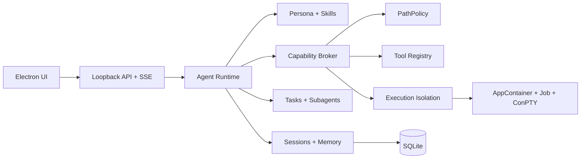

<div align="center">
  

  # RainyDays

  **一个面向真实工作的本地优先 AI Agent 桌面运行时**

  *A local-first AI agent desktop runtime built for real work.*

  [](https://www.typescriptlang.org/)
  [](https://www.electronjs.org/)
  [](https://nodejs.org/)
  [](#环境要求)
  [](#项目状态)

  [功能亮点](#功能亮点) · [快速开始](#快速开始) · [安全架构](#安全架构) · [项目状态](#项目状态) · [项目文档](#项目文档)
</div>

---

## 关于 RainyDays

RainyDays 是面向少量同事的本地优先 AI 桌面助手。完整产品规划覆盖文件、研究、文档与重复任务，以及代码修改与测试、CLI、MCP、浏览器和 Windows 应用操作。项目参考 **Lux Desktop v0.1.898** 的核心行为，复用现有 Agent Runtime，以真实工作结果验收；规划中的能力不代表当前已经可用。

项目坚持三个核心方向：

- **本地优先**：会话、配置、记忆与工作数据保存在本地受管目录中。
- **能力可治理**：工具调用、路径访问和进程执行均经过明确的授权边界。
- **证据驱动**：功能完成度以契约、负向测试、真实环境回执和打包验证为准，而不是只看“代码能跑”。

> [!IMPORTANT]
> RainyDays 仍在开发，尚无通过本轮全部验收的同事版安装候选。当前状态见 [STATUS](docs/STATUS.md)；后续开发从 [Codex 研发手册](docs/agents/README.md) 和 [D+A 总任务图](docs/work/general-agent/plan.md) 进入。完整 Lux 复刻不作为交付门槛，Prism、钉钉不在范围内。

## 功能亮点

以下包含已有工程模块，不能据此判断当前默认助手或安装版均已验收。完整规划与冻结范围以 [通用规格](docs/specs/general-agent.md) 和 STATUS 为准。

<table>
<tr>
<td width="50%" valign="top">

### 🧠 Agent Runtime

- 多会话管理与会话导入、导出、分叉
- Persona 与 Skill 动态组合
- 长对话压缩与持久化记忆
- 任务拆解、依赖追踪与执行状态管理
- 子 Agent 派遣、观察、通信与终止

</td>
<td width="50%" valign="top">

### 🛠️ 工具系统

- 文件读取、搜索、精确编辑与写入
- Shell、持久终端与 Node.js Script
- Web 获取、搜索与文件下载
- DOCX / XLSX 文档生成
- 定时任务、Playbook、Oracle 与跨会话通信

</td>
</tr>
<tr>
<td width="50%" valign="top">

### 🔐 安全边界

- Capability Broker 统一能力授权
- PathPolicy 路径身份校验与作用域隔离
- Windows AppContainer + Job Object 执行隔离
- Electron 主进程私有认证与人工执行同意链
- 执行清单、攻击矩阵与原生真实性回执

</td>
<td width="50%" valign="top">

### 🖥️ 桌面体验

- Electron 桌面应用
- 流式响应与工具调用可视化
- Persona、模型与工作目录设置
- 会话、任务、记忆和文件查看界面
- NSIS 安装包构建与完整性检查

</td>
</tr>
</table>

## 架构概览



RainyDays 将“模型决定做什么”和“系统允许做什么”分离：LLM 只能提出工具调用，实际参数校验、路径授权、运行时所有权和执行隔离由宿主系统完成。

## 环境要求

当前完整构建链面向 **Windows x64**，并锁定以下主要环境：

| 组件 | 要求 |
|---|---|
| 操作系统 | Windows 10 / 11 x64 |
| Node.js | `>=24.14.1 <25` |
| npm | `>=11.11.0 <12` |
| Visual Studio | 2022，安装“使用 C++ 的桌面开发” |
| MSVC Toolset | `14.43.34808` |
| Windows SDK | `10.0.22621.0` |

原生隔离组件使用固定工具链构建；版本或产物身份不匹配时，检查会失败关闭，而不会静默降级为普通子进程。

## 快速开始

### 1. 克隆并安装依赖

```powershell
git clone https://github.com/m1rzen/rainydays.git
cd rainydays
npm ci
```

> 当前仓库为 Public；克隆不需要GitHub登录。

### 2. 配置模型

启动桌面应用后，在 **Settings → Providers** 中添加OpenAI-compatible Provider、模型、API Key和Base URL。API Key由Electron `safeStorage`保护并保存到独立凭据vault；`config.json`只保存opaque credential reference，不保存明文密钥。

开发态首次启动也可以从环境变量迁移配置；迁移成功后请从启动环境中移除API Key：

```powershell
$env:LLM_API_KEY = "your-api-key"
$env:LLM_BASE_URL = "https://your-provider.example/v1"
$env:LLM_MODEL = "your-model-name"
npm run electron:dev
```

`config.json`、`.env`、凭据vault、数据库和其他本地运行数据均已被Git忽略。请勿将真实密钥提交到仓库、日志或Issue。

### 3. 启动桌面应用

Windows 下可以直接在项目文件夹中双击 **`启动 RainyDays.cmd`**。启动程序会先完成构建，再打开 RainyDays 桌面窗口；构建记录保存在 `test-results/desktop-launch.log`。

`public/index.html` 是桌面应用的界面文件，需要应用服务才能工作。直接在浏览器中打开它会显示启动说明。

也可以从终端启动：

```powershell
npm run electron:dev
```

该命令会构建原生隔离组件、生成构建身份、编译 TypeScript，然后启动 Electron。

如只需启动开发服务器：

```powershell
npm run dev
```

默认仅监听 `http://127.0.0.1:3111`。

## 常用命令

| 命令 | 说明 |
|---|---|
| `npm run typecheck` | TypeScript 类型检查 |
| `npm run lint` | ESLint 严格检查 |
| `npm run build` | 构建服务端、原生组件与完整性清单 |
| `npm run electron:dev` | 构建并启动桌面应用 |
| `npm run dist:dir` | 生成未安装的 Electron 目录构建 |
| `npm run dist` | 生成 Windows NSIS 安装包 |
| `npm run test:quick` | 快速验证配置 |
| `npm test` | 完整分层测试门禁 |
| `npm run test:coverage` | 运行冻结覆盖率门禁 |
| `npm run parity:verify` | 验证锁定的 Lux Desktop 基线 |
| `npm run gate:gov04` | 运行合并治理门禁 |

完整门禁包含 Unit、Contract、Integration、Electron、Packaged、Coverage 与治理自测；部分测试需要 Windows 原生工具链或已构建的安装候选。

## 安全架构

RainyDays 将安全约束作为运行时设计的一部分，而不是只依赖 Prompt：

1. **Capability Broker**：按 Session、Persona、工具和调用上下文决定能力是否可见、可执行。
2. **PathPolicy**：使用受管根目录和对象身份校验限制文件访问，阻断路径穿越、链接逃逸与根目录替换。
3. **Execution Isolation**：受治理的执行入口通过 Windows AppContainer、Job Object 与 ConPTY 运行，限制文件、网络、环境变量和进程生命周期。
4. **Private Consent Chain**：人工终端操作需要 Electron 主进程参与的短时同意，授权不会暴露给 Renderer 或普通 HTTP 调用方。
5. **Evidence Gates**：执行 sink inventory、攻击矩阵、真实宿主回执和候选身份绑定共同决定测试是否可以宣告通过。

详细设计请参阅：

- [`SEC-01 Capability Broker`](parity/SEC-01-CAPABILITY-BROKER-ARCHITECTURE.md)
- [`SEC-02 PathPolicy`](parity/SEC-02-PATH-POLICY-ARCHITECTURE.md)
- [`SEC-03 Execution Isolation`](parity/SEC-03-EXECUTION-ISOLATION-ARCHITECTURE.md)
- [`GOV-04 CI Architecture`](parity/GOV-04-CI-ARCHITECTURE.md)

如果发现安全问题，请不要在公开 Issue 中披露密钥、用户数据或可直接利用的攻击细节；请通过仓库所有者提供的私有渠道报告。

## 项目状态

当前产品状态以 [docs/STATUS.md](docs/STATUS.md) 为准。以下保留历史模块记录，不能把其中全量 parity 或旧逐卡流程作为同事版的新增门槛。

| 工作流 | 当前状态 |
|---|---|
| GOV-01～GOV-04 治理基础 | 已建立基线、版本、测试和发布治理框架 |
| SEC-01 Capability Broker | 已实现并具备契约与攻击性测试 |
| SEC-02 PathPolicy | 运行时与候选门禁已闭合；累计 Coverage 债务仍隔离跟踪 |
| SEC-03 Execution Isolation | **进行中**：原生隔离与真实性原语已建立，完整真实宿主回执集仍待闭合 |
| TOOL-06 Streaming Download | **WIP**：后台任务、状态/等待/取消、Range/If-Range 续传、身份绑定 partial、原子发布、SHA-256 与安全文件名已实现；独立复审待恢复 |
| REL-03 Crash Recovery & Safe Mode | **WIP**：main/renderer/service crash-loop 会进入不启动后端或原生执行的恢复窗口；固定维度 crash ledger、脱敏诊断和一次性正常重试已实现，独立复审待恢复 |
| REL-04 Observability & Diagnostics | **WIP**：结构化脱敏日志与关联标识、`live` / `ready` / `degraded` 健康状态、固定维度聚合指标和不超过 256 KiB 的诊断包已实现；3 个 P1 已完成修复与定向验证，等待新的独立只读复审；P2 DB 全量 instrumentation 仍明确隔离 |
| RT-10 Background Service & Crash Recovery | **WIP**：核心生命周期、LLM/DB/Terminal 三类中断恢复与 resolved governance 均已通过；独立复审基础设施连续两次无法创建 Session，已按反卡死纪律搁置 |
| DS-01 Electron Main Lifecycle | **WIP**：窗口 bounds/maximized/fullscreen 状态存储、多显示器可达恢复、菜单、单实例 Session 参数、renderer crash 有界恢复和聚合安全退出已实现；治理与独立复审待收敛 |
| Lux Desktop 全量 Parity | **历史参考**，当前以同事任务、安装与试用结果验收；见研发手册 |

### 2026-08-28 开发快照

当前工作位于开发分支 `agent/data01-ds02-foundation`；REL-04 的 P1 修复尚未推送，不代表该卡已达到发布或闭合条件。

- 新增收口证据：TypeScript typecheck、受影响文件 ESLint、REL-04 Unit 8/8、Contract 7/7、真实 API Integration 1/1、`process-cwd` 2/2、EVT-02 detached flow 1/1。此前 Electron 9/9 和安装候选 REL-04 探针证据保持有效，未重复运行长门禁。
- 已修复、待独立复审的 P1：LLM/HTTP observation 的 once-only 生命周期、结构化 logger 与既有 `process-cwd` 安全证据消费者的兼容、后台 EventBus/Cron/Poll Agent run 的 session/run correlation。
- 已记录的 P2：当前 Database 指标覆盖边界/探针与事务，而不是所有直接 SQL 操作。
- RT-10 核心切片已通过：Supervisor Unit 6/6、真实 service ready/control/shutdown 1/1、Electron 后端强杀与 Session 恢复 1/1、win-unpacked 后端强杀恢复与退出清理 1/1，以及受影响后的 Electron 9/9；正式包使用 ASAR unpacked runtime projection 作为受验证 CWD。
- RT-10 的 LLM/DB/Terminal 中断切片均已通过：流式请求中强杀后没有重复 Provider 请求且下一轮 Chat 可继续；SQLite 开放事务被强杀后完整回滚，同一副作用可且仅可重试一次；运行中的隔离 Terminal 进程树会随服务崩溃清理，重启后无幽灵 Terminal 且仅创建一个替代实例。完整恢复 UI 留给 REL-03/DS-01 边界。
- RT-10 resolved governance 7/7 已通过；两次独立只读 review Routine 均在创建 Session 时立即失败，未产生代码 finding，已列入搁置并停止重试。因此当前保持 WIP，不将“review 基础设施失败”误报为“独立复审通过”。
- RT-10 unified runner 中 Unit 6/6、Contract 7/7、Integration 3/3、Electron 10/10、win-unpacked 1/1 均实际通过且 artifact unchanged；仅因聚焦 win-unpacked 测试不生成 installer lifecycle detail report，被 packaged report schema 标为 `REPORT_VALIDATION`，Coverage/self-test 因而未启动。该 schema/installer 边界已搁置，不重复长门禁。
- DS-01 当前聚焦证据已通过：Window lifecycle Unit 4/4；真实 Electron 1/1 完成离屏状态回收、退出持久化/重启恢复、第二实例 Session 定向、renderer 强杀自动重载与服务存活、退出后服务树清理；既有 Electron desktop smoke 9/9 保持通过。
- REL-03 已完成最小恢复切片：连续三次真实 main 崩溃、连续三次 renderer 崩溃或六次 service 崩溃均进入 backend-free Safe Mode；恢复页仅显示固定维度的 build/reason/count 诊断并提供一次性正常重试/退出；独立 native host 强杀保持 service 存活，且只允许一个新的运行中 Terminal。
- 安装候选在 REL-04 探针完成后，于既有 Session/卸载清理尾段报告范围外 `CLEANUP`；该问题以及隔离的 SEC-02 累计 Coverage 债务均未在本次 WIP 中宣称解决。
- 本地 `deliverables/` 构建与诊断产物不纳入版本库。

项目不会将“已实现”自动等同于“已完成”。当前按票据相关行为、真实任务与发布阶段的安装/恢复证据提升状态，执行尺度见研发手册；上述历史冻结门禁不自动成为每个新功能的前置。

## 项目结构

```text
rainydays/
├─ electron/          # Electron 主进程、preload 与桌面启动链
├─ native/            # Windows AppContainer / Job / ConPTY 原生宿主
├─ parity/            # Lux 基线、架构冻结、Schema 与治理报告
├─ personas/          # 内建 Persona
├─ public/            # Web UI 与静态资源
├─ scripts/           # 构建、测试、治理与完整性工具
├─ skills/            # 可组合 Skill
├─ src/               # Agent Runtime 与工具实现
└─ tests/             # Unit / Contract / Integration / Electron / Packaged
```

## 项目文档

- [Codex 专用研发手册](docs/agents/README.md)
- [通用Agent规格与31项总任务](docs/work/general-agent/plan.md)
- [基础工作流18项任务](docs/work/colleague-delivery/plan.md)
- [同事使用指南（随研发完善）](docs/user-guide.md)
- [Lux 核心行为逆向计划](docs/research/lux-reference-plan.md)
- [历史资料索引（按需查询）](docs/archive/README.md)

## 贡献约定

修改应用代码后，日常反馈入口为：

```powershell
npm run check:product
```

纯文档变更核对链接、事实和任务依赖即可。受影响的安全边界、路径、进程执行需加对应行为回归；当前候选在发布阶段完成安装与恢复验证。尺度见 [执行流程](docs/agents/workflow.md)。不要提交 `.env`、`config.json`、数据库、模型文件、构建产物或包含真实用户数据的测试材料。

---

<div align="center">
  <strong>RainyDays</strong> — 为复杂工作带来清晰、秩序与可验证的执行力。
</div>
