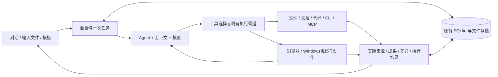

# 沿用现有内核的架构实施指南

2026-10-18 源码阅读快照，入口随代码演进更新。本文定义查找位置和行为边界，不要求按图拆文件。代码/CLI/MCP/浏览器/原生Windows/技能/子任务的接入与现状见[通用能力手册](general-agent-capabilities.md)，均复用以下同一主流程。

## 主流程

一个任务运行链、一个默认助手、一个当前本地数据目录。模板与交互对话共用执行路径。真实原生隔离和 IPC 是现有组件，复用即可。

## 模块与可验证接口

| 用户能力 | 现有入口 | 应保持的契约 |
|---|---|---|
| 对话/工具循环 | src/agent.ts、src/session-runtime.ts、src/tool-pipeline.ts | run 生命周期清楚；停止传播；同一写入不被自动重放 |
| 模型/流 | src/llm.ts、src/model-connection.ts | 已有输出后不隐式重发；工具参数完整；额度与认证错误可行动 |
| 上下文 | src/memory.ts、src/task-tools.ts | 原始记录保留；请求预算包括工具 schemas；摘要失效不假装完整理解 |
| 文件输入 | attachment-*、document-parser*、tools/filesystem-lux.ts | 读取范围与分页明确；长文可定位；解析失败可见 |
| 研究 | src/research-sources.ts、src/fetch-runtime.ts、tools/web.ts | 读取状态来自宿主；事实正确性另验 |
| 输出 | src/document-outputs.ts、tools/writer.ts、file-viewer.ts | 仅真实成功工具结果登记；可打开/复读/修改/重启恢复 |
| 配置/目录 | src/config.ts、settings-*、src/index.ts | 部门内容源可缺省；资料范围和输出路径清楚 |
| 重复任务 | 现有 playbook.ts/routine.ts 先评估复用 | 只保存任务参数，普通 Agent 执行；不导出旧授权 |
| 持久化/恢复 | src/db.ts、session.ts、bootstrap-database.ts、data-backup.ts | 一致快照、迁移失败可恢复、不以旧库覆盖新内容 |
| 桌面/发布 | electron/main.cjs、recovery-state.cjs、scripts/build-electron.mjs | 安装与开发路径区别明确；运行包包含必要依赖 |

上述是导航，不是“各文件都必须改”的清单。

## 现在值得修的具体缺口

1. D01已修复旧工作台文件根400和失效目录子路径；D02补read绝对路径不依赖DATA_ROOT；D04补任务结果/停止/响应保留。历史单次后台退出仍未知，D13测启动负载；可选网络资料源与其他工具根依赖交D05。证据以各票为准。
2. D03已在LLM最终投影检查profile请求预算，Agent在动态schemas/任务提示完成后整理历史；摘要自身同样受预算、超时与取消约束。UI的tokens仍是近似估算，真实容量由D02认证。
3. D03已取消静默裁剪与摘要失败后删除；用户原始要求、成果引用和最近完整工具组保留。read(history:)分页取回当前会话原文，20轮加真实进程重启链路通过；真实模型语义质量留F04。
4. 当前 DEFAULT 工具选择已有按需加载；R5 的描述体积收益不等于模型任务成功率。D02/D07/D15 测真实请求。
5. Playbook/Routine 已有工程能力，普通用户没有单一入口。D10 在“保存任务说明”与“执行脚本”间明确边界，优先轻量 metadata + 普通 run。

这些是代码观察和已有诊断线索；未经新复现的内容不得写成已确认生产故障。

## 设计任务模板

最小持久信息：版本、模板 ID/名称、任务目标、输入字段及类型、输出规则、可编辑指令、创建时间、可选源会话/成果引用。运行时记录模板版本快照与新输入。

范围许可、密钥、机器专属路径、原会话附件正文不进入可分享模板。输出路径每次可选；缺字段在发模型请求前指出。重跑仍是新任务；不承诺逐步骤确定重放。

先检查既有 managed store/设置形式能否承载。只有行为确需新增表时才做一次最小迁移，复用恢复链。不引入可视化 DAG 编辑器、常驻调度器或新的模板脚本语言。

## 任务状态与成果

runId 关联界面、LLM、工具和最终状态；现有事件足够时做投影。只有当前事件缺信息才扩展统一事件契约。最终状态与“文件已经写好”分开，避免中断后成果消失或失败被报成成功。

成果最小信息：实际路径/稳定句柄、格式、创建时间、来源 run、验证状态；版本关系按需增加。不要将模型随口提到的文件路径当成成果，也不要建立另一套内容寻址存储来重写现有文件系统。

文件整理使用一个有序计划及执行结果，未执行/成功/冲突明确。撤回只处理可验证仍由本次修改形成的状态；外部变化交给用户，避免撤回覆盖同事刚做的编辑。

## 重构触发条件

只有当前票无法用现有接口清楚表达，或一次用户改动必须同时修改多处相同规则时才提取模块。先集中行为再移动文件。原生执行/数据库底层/权限 broker 的重写需独立收益实验和决定，不能混入功能票。
